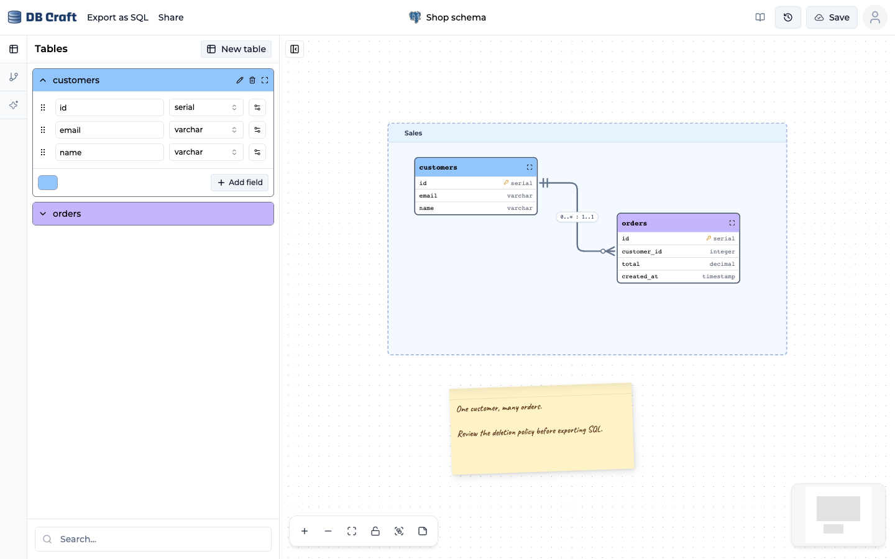
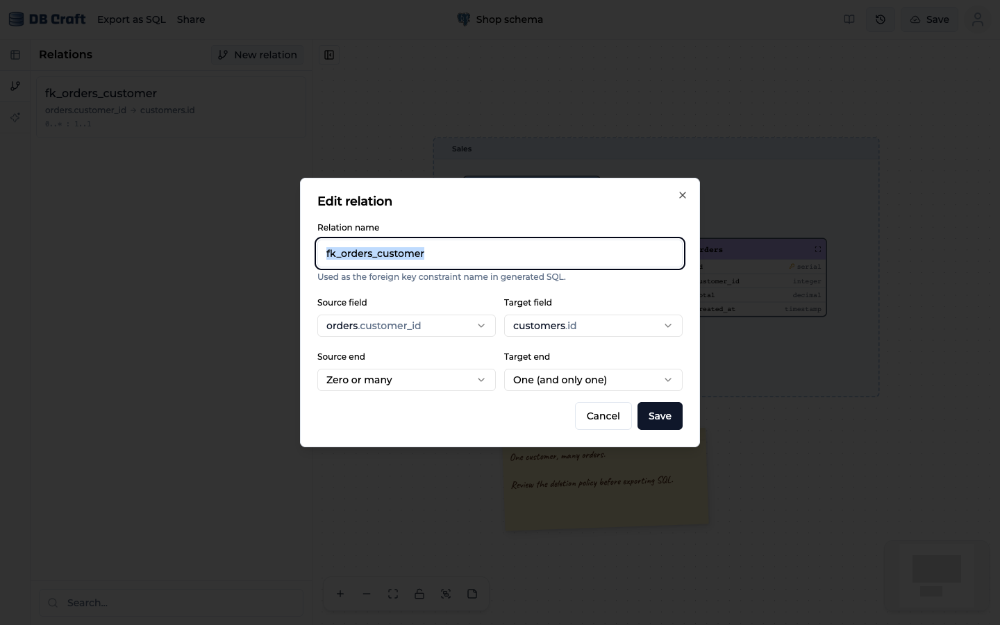
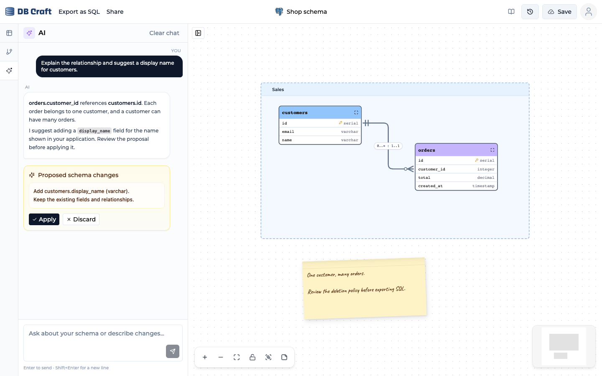
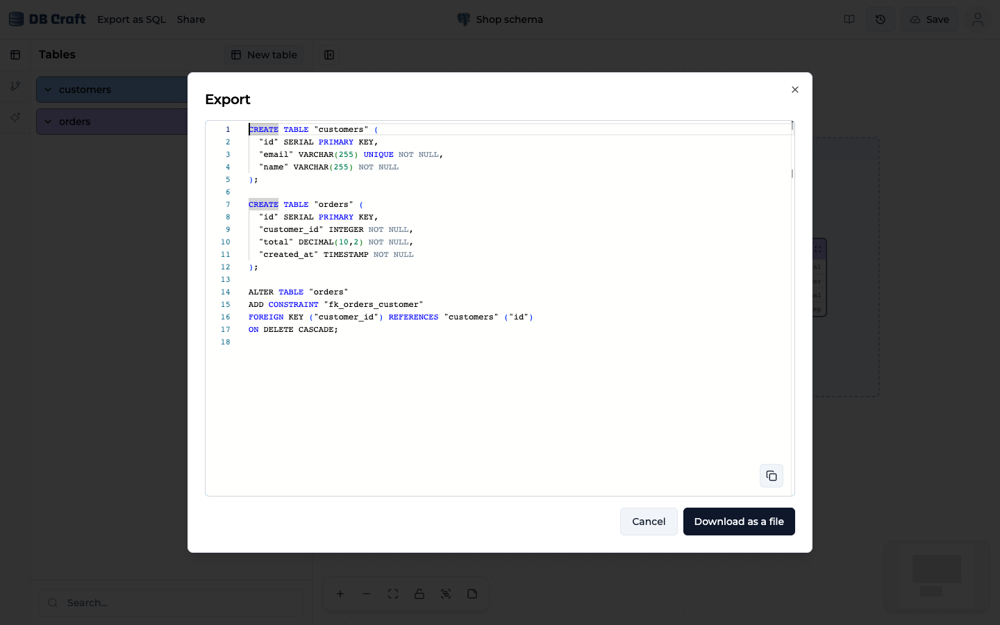
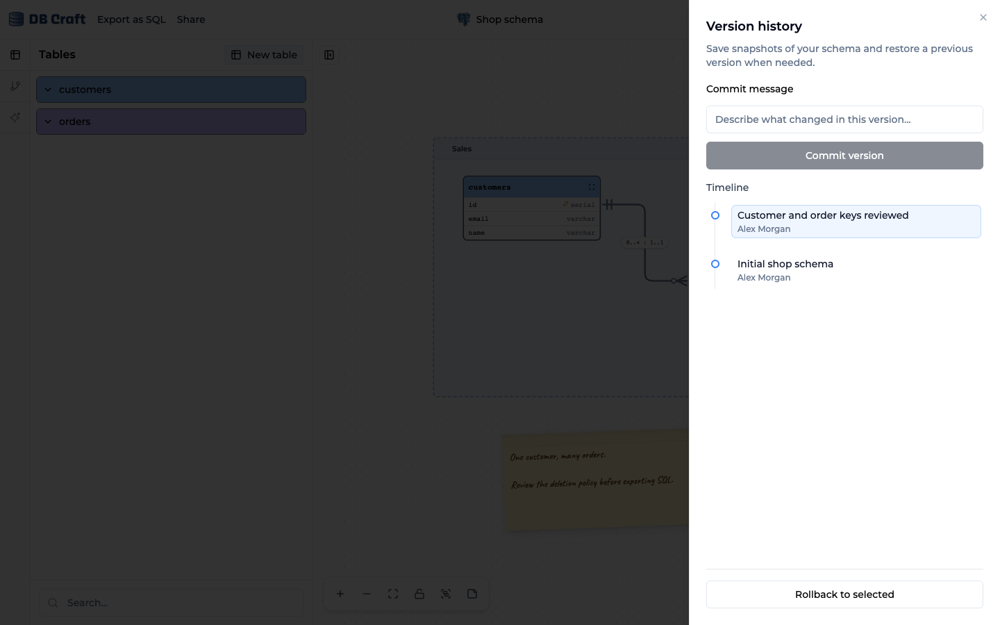
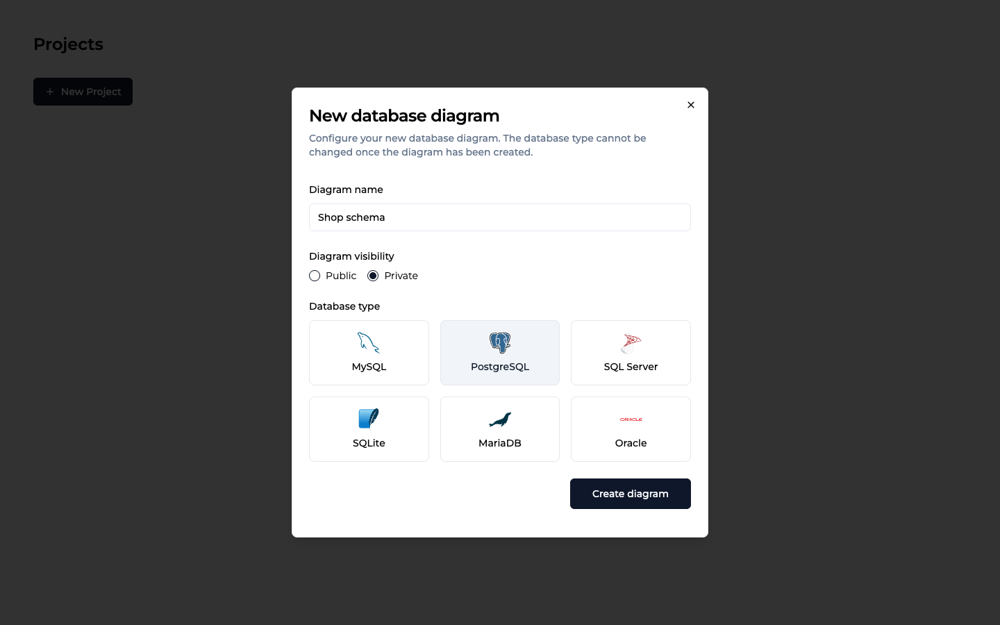

<p align="center">
  
</p>

<p align="center">
  <strong>A visual database designer for developers.</strong><br />
  Draw tables, fields, and relationships, then export SQL you can run yourself.
</p>

<p align="center">
  <a href="#features">Features</a>
  &nbsp;·&nbsp;
  <a href="#getting-started">Getting started</a>
  &nbsp;·&nbsp;
  <a href="#tutorial">Tutorial</a>
</p>

<p align="center">
  
</p>

DB Craft is a web app for designing database schemas. A project holds the tables, fields,
relationships, groups, and notes that make up a diagram. You arrange that diagram on a canvas, and
when the structure is ready you export SQL for your own database tools.

## Features

<table>
  <tr>
    <td width="50%" valign="top">
      
      <h3>Relationships</h3>
      Name the foreign key, pick the fields on each side, and set cardinality. The canvas draws the
      link and labels both ends.
    </td>
    <td width="50%" valign="top">
      
      <h3>AI assistant</h3>
      Ask about the current schema or describe a change. Suggested edits stay in a review card until
      you apply or discard them.
    </td>
  </tr>
  <tr>
    <td width="50%" valign="top">
      
      <h3>SQL export</h3>
      Generate <code>CREATE TABLE</code> statements and constraints in the dialect of the database
      you chose for the project. Copy the script or download it as a file.
    </td>
    <td width="50%" valign="top">
      
      <h3>Version history</h3>
      Save a snapshot with a short message, then roll the diagram back to an earlier version when
      you need it.
    </td>
  </tr>
</table>

<p align="center">
  
</p>

- **Six databases.** MySQL, PostgreSQL, SQL Server, SQLite, MariaDB, and Oracle. The type you pick
  sets the field list and the SQL that export produces. It stays fixed after the project is created.
- **Notes and groups.** Color a region of the canvas and leave a note next to the tables it
  explains.
- **Sharing.** A public diagram gets a read-only link. A private diagram stays in your account.
- **Teams.** Admins and editors work on the same diagram, with presence avatars, live cursors, and
  automatic saving. Viewers can open it without editing.
- **Languages.** The interface is available in English, Ukrainian, and Polish.

## Getting started

You need Node.js 20.19+ or 22.12+ (Node 24 LTS is a good default) and yarn.

```bash
git clone https://github.com/maks-kovpak/db-craft.git
cd db-craft
yarn install
cp .env.example .env
yarn dev
```

Open [http://localhost:3000](http://localhost:3000). Fill in `.env` before the app can talk to its
services:

| Variable               | Used for                                         |
| ---------------------- | ------------------------------------------------ |
| `SUPABASE_URL`         | Supabase project URL                             |
| `SUPABASE_KEY`         | Supabase anon key                                |
| `NUXT_PUBLIC_SITE_URL` | Public site URL, `http://localhost:3000` locally |
| `GROQ_API_KEY`         | AI assistant                                     |

## Tutorial

The public tutorial lives at `/tutorial`. It is a set of searchable guides, with screenshots and
captioned videos, and it follows the interface language: Ukrainian when the UI is Ukrainian, English
otherwise.

Articles live in `content/tutorial/` (and `content/tutorial/uk/` for the translation). See
[the authoring guide](content/TUTORIAL.md) for how to add a page, where media goes, and how to check
it.

## License

MIT. See [LICENSE](LICENSE).
